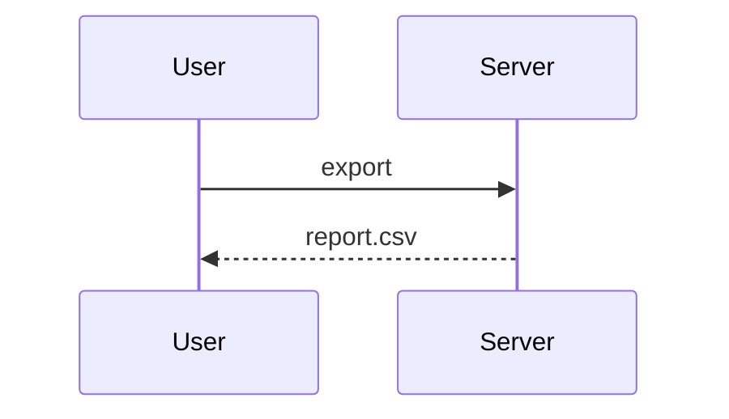

# Architecture

RED: UC-14 has a sequence diagram; UC-1 does not. The old validator matched
UC-ids as substrings, so UC-14's heading also "covered" UC-1. A bare mention
of UC-1 in prose far from any diagram (below) is not evidence either.

UC-1 is described in the SRS.

## Context

Filler paragraph one.

Filler paragraph two.

Filler paragraph three.

Filler paragraph four.

Filler paragraph five.

Filler paragraph six.

### Sequence UC-14: export report

